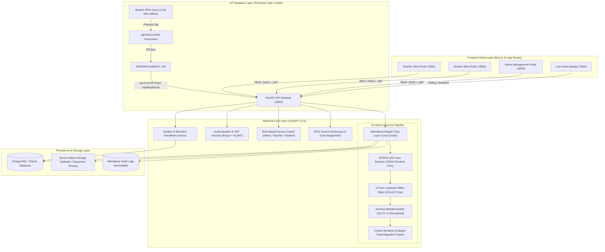

# SmartAttend — System Architecture Specification

## 1. System Overview

**SmartAttend** is a production-grade AIoT (Artificial Intelligence of Things) attendance management ecosystem designed for academic and enterprise institutions. It replaces manual paper attendance registers and easily spoofed proxy attendance systems through a **deterministic two-layer verification architecture**:

1. **Layer 1: Campus Perimeter Physical Verification (IoT / RFID)**
   - High-throughput morning entrance check-in via ESP8266 NodeMCU 12E hardware nodes coupled with MFRC522 (13.56 MHz SPI) RFID transceivers.
   - Provides physical presence ground-truth timestamped per student per day.
2. **Layer 2: In-Classroom Biometric Verification (Computer Vision / Edge AI)**
   - High-resolution classroom photograph capture by course instructor via mobile or web client.
   - Concurrent multi-face detection using **InsightFace SCRFD-10G ONNX** with 5-point facial landmark regression.
   - 5-point affine transformation aligning faces to standard $112 \times 112 \times 3$ crops.
   - Deep feature extraction generating 512-dimensional L2-normalized embeddings via **ArcFace-MobileFaceNet**.
   - Dual-matrix disambiguation matching faces against enrolled division vectors, cross-referenced with Layer 1 RFID presence.
3. **Layer 3: Human-in-the-Loop Teacher Review & Finalization**
   - Active sessions preserve undetected students in **`PENDING`** state (never automatically marked absent).
   - Instructors inspect annotated visual bounding-box overlays, resolve flagged or ambiguous detections, and manually review anomalies.
   - Formal finalization commits an **immutable database lock** with structured audit trails.

---

## 2. End-to-End Architectural Topology

---

## 3. Two-Layer Verification State Matrix

The core attendance engine evaluates student presence through a deterministic state machine:

| Layer 1: Daily RFID | Layer 2: Classroom AI Face | Intermediate Status | Verification Source | Action / Teacher Review | Final Status |
| :---: | :---: | :---: | :---: | :---: | :---: |
| **Yes** | **Yes** | `PRESENT` | `RFID_AND_AI` | Verified Present | **PRESENT** |
| **Yes** | **No** | `FLAGGED` | `RFID_ONLY` | Flagged: Student on campus but missing in photo | Teacher confirms presence or marks absent |
| **No** | **Yes** | `FLAGGED` | `AI_ONLY` | Flagged: Detected in photo without gate RFID scan | Teacher confirms presence or marks absent |
| **Ambiguous** | **Yes** | `FLAGGED` | `AMBIGUOUS_AI` | Close similarity score (<0.08 margin between students) | Teacher resolves candidate flag |
| **No** | **No** | `PENDING` | `UNVERIFIED` | **Pending Review** (Never marked absent automatically) | Becomes `ABSENT` upon teacher confirmation |

---

## 4. Edge Authentication & Role Boundary Isolation

- **Token Format**: HS256 Signed JSON Web Tokens (JWT) containing `sub` (email), `user_id`, `role`, and expiration (`exp`).
- **Edge Middleware (`src/middleware.ts`)**: Evaluates incoming HTTP requests on Edge runtimes before Next.js page rendering:
  - Unauthenticated requests to `/teacher`, `/student`, or `/admin` are intercepted with HTTP 307 redirecting to `/login?next=...`.
  - Authenticated students accessing `/teacher` or `/admin` are blocked and redirected to `/unauthorized`.
  - Authenticated faculty accessing `/student` are redirected to `/unauthorized`.
- **Backend Permissions (`app/core/permissions.py`)**: Strict FastAPI dependency injection guards verifying database user status and active role tokens.
