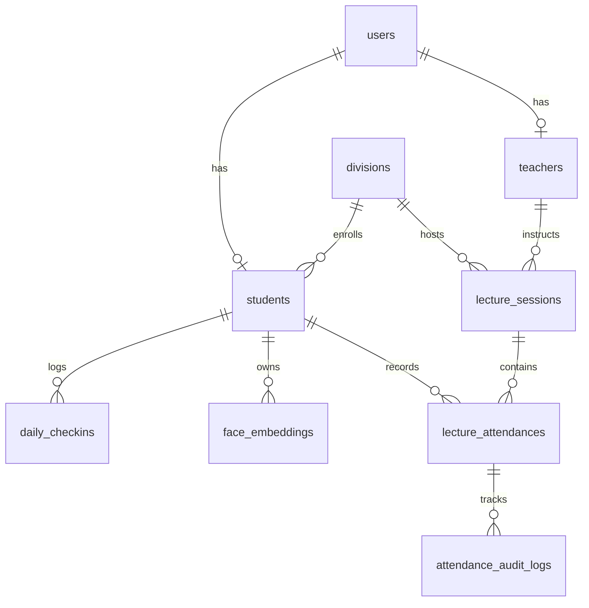

# SmartAttend — Database Schema & Data Models

## 1. Schema Architecture

The database architecture uses SQLAlchemy 2.0 declarative models compatible with both local SQLite development and production PostgreSQL (Supabase / AWS RDS).

---

## 2. Table Specifications

### 1. `users`
Authentication accounts for all roles.
- `id` (Integer, Primary Key)
- `email` (String 255, Unique, Indexed)
- `username` (String 100, Unique, Indexed)
- `full_name` (String 255)
- `hashed_password` (String 255)
- `role` (String 50): `ADMIN`, `TEACHER`, `STUDENT`
- `is_active` (Boolean, Default True)
- `created_at` (DateTime UTC)
- `updated_at` (DateTime UTC)

### 2. `students`
Student profile and enrollment metadata.
- `id` (Integer, Primary Key)
- `user_id` (Integer, ForeignKey `users.id`, Unique)
- `roll_no` (String 50, Unique, Indexed)
- `prn` (String 50, Nullable, Unique)
- `name` (String 255)
- `email` (String 255, Indexed)
- `department` (String 100)
- `year` (String 50)
- `division` (String 50, Indexed)
- `rfid_uid` (String 50, Nullable, Unique, Indexed)
- `face_enrolled` (Boolean, Default False)
- `is_active` (Boolean, Default True)
- `created_at` (DateTime UTC)

### 3. `teachers`
Faculty metadata and division assignments.
- `id` (Integer, Primary Key)
- `user_id` (Integer, ForeignKey `users.id`, Unique)
- `teacher_id` (String 50, Unique, Indexed)
- `name` (String 255)
- `email` (String 255, Indexed)
- `department` (String 100)
- `_assigned_divisions` (Text / JSON list of strings)
- `is_active` (Boolean, Default True)
- `created_at` (DateTime UTC)

### 4. `divisions`
Academic classes and divisions.
- `id` (Integer, Primary Key)
- `name` (String 50, Indexed)
- `code` (String 50, Unique)
- `academic_year` (String 50)
- `semester` (String 50)
- `department` (String 100)
- `total_students` (Integer, Default 0)
- `class_teacher` (String 255, Nullable)
- `is_active` (Boolean, Default True)

### 5. `subjects`
Course curriculum entities.
- `id` (Integer, Primary Key)
- `name` (String 255)
- `code` (String 50, Unique, Indexed)
- `department` (String 100)
- `semester` (String 50)
- `is_active` (Boolean, Default True)

### 6. `lecture_sessions`
Individual class lecture periods.
- `id` (Integer, Primary Key)
- `subject` (String 255, Indexed)
- `title` (String 255)
- `division` (String 50, Indexed)
- `teacher_id` (Integer, ForeignKey `teachers.id`, Indexed)
- `date` (Date, Indexed)
- `start_time` (Time)
- `end_time` (Time, Nullable)
- `classroom` (String 100, Nullable)
- `status` (String 50): `SCHEDULED`, `IN_PROGRESS`, `REVIEW_PENDING`, `FINALIZED`
- `classroom_photo_url` (String 500, Nullable)
- `overlay_image_url` (String 500, Nullable)
- `created_at` (DateTime UTC)

### 7. `daily_checkins`
Campus perimeter RFID morning scans.
- `id` (Integer, Primary Key)
- `student_id` (Integer, ForeignKey `students.id`, Indexed)
- `date` (Date, Indexed)
- `check_in_time` (DateTime UTC)
- `rfid_uid` (String 50, Indexed)
- `device_id` (String 50, Indexed)
- `is_verified` (Boolean, Default True)
- *Constraint*: `UniqueConstraint(student_id, date)` prevents duplicate entries.

### 8. `lecture_attendances`
Lecture-specific attendance records.
- `id` (Integer, Primary Key)
- `lecture_session_id` (Integer, ForeignKey `lecture_sessions.id`, Indexed)
- `student_id` (Integer, ForeignKey `students.id`, Indexed)
- `status` (String 50): `PRESENT`, `ABSENT`, `FLAGGED`, `PENDING`
- `verification_source` (String 50): `RFID_AND_AI`, `RFID_ONLY`, `AI_ONLY`, `AMBIGUOUS_AI`, `TEACHER_MANUAL`, `UNVERIFIED`
- `ai_confidence` (Float, Nullable)
- `rfid_checked_in` (Boolean, Default False)
- `ai_detected` (Boolean, Default False)
- `teacher_action` (String 255, Nullable)
- `finalized` (Boolean, Default False)
- *Constraint*: `UniqueConstraint(lecture_session_id, student_id)` prevents duplicate records.

### 9. `attendance_audit_logs`
Immutable audit log tracking all attendance overrides and finalizations.
- `id` (Integer, Primary Key)
- `user_id` (String 100, Indexed)
- `role` (String 50)
- `action` (String 100, Indexed)
- `entity_type` (String 100)
- `entity_id` (String 100, Nullable)
- `_details` (Text / JSON payload with previous and new states)
- `timestamp` (DateTime UTC, Indexed)

### 10. `devices`
IoT hardware reader registration.
- `id` (Integer, Primary Key)
- `device_id` (String 50, Unique, Indexed)
- `device_name` (String 100)
- `location` (String 100)
- `ip_address` (String 50, Nullable)
- `status` (String 50): `online`, `offline`, `maintenance`
- `last_ping` (DateTime UTC)
- `firmware_version` (String 50)

### 11. `face_embeddings`
Registered facial biometric vectors.
- `id` (Integer, Primary Key)
- `student_id` (Integer, ForeignKey `students.id`, Indexed)
- `embedding` (Text / JSON 512-dimensional normalized float array)
- `quality_score` (Float, Nullable)
- `image_url` (String 500, Nullable)
- `model_version` (String 50, Default "arcface-mobilefacenet-512d")
- `created_at` (DateTime UTC)
